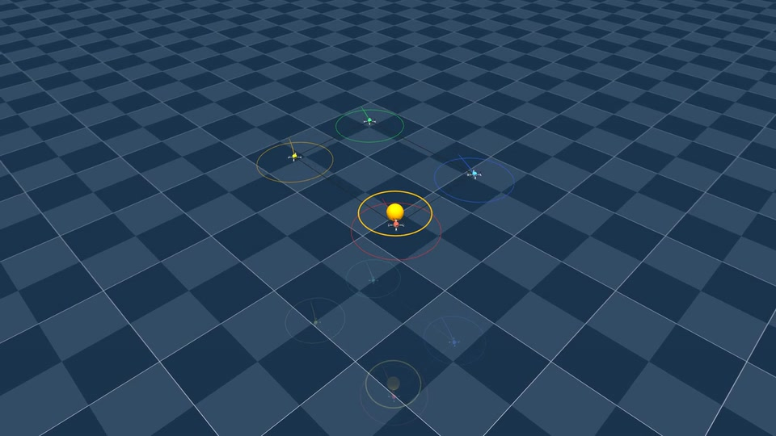
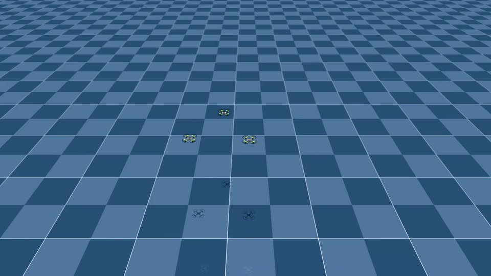
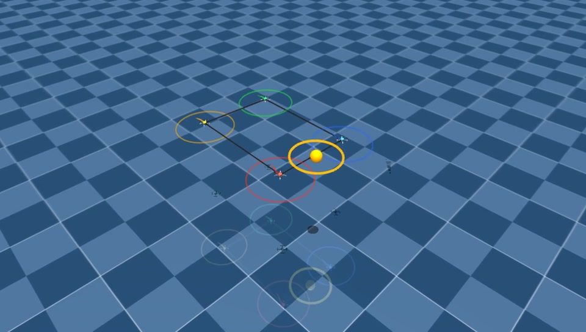
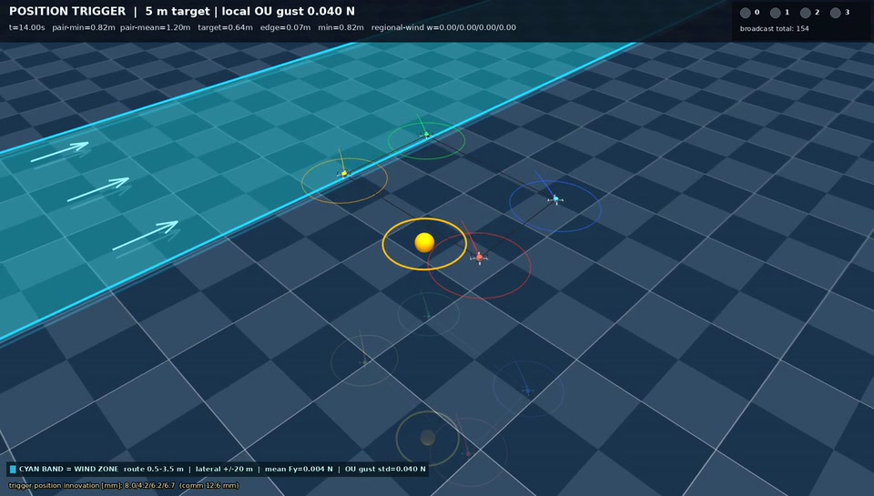
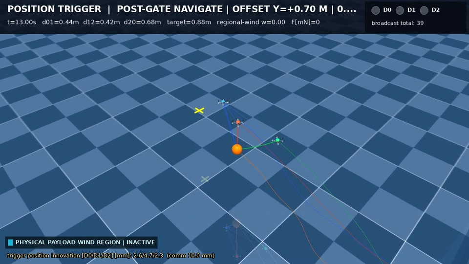
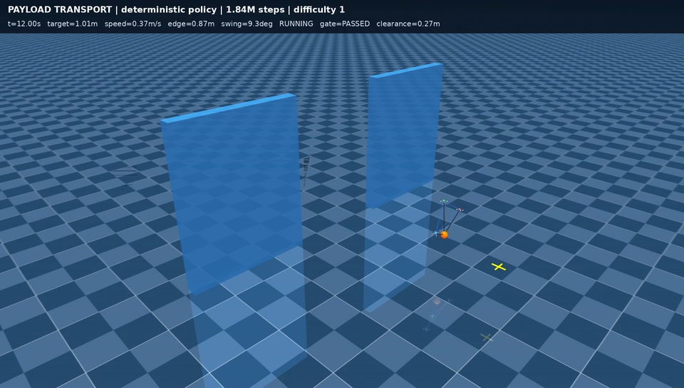

# Hi, I'm Yachen Tian

I work on reinforcement learning, robotics, and multi-agent systems, with a
focus on reliable evaluation and reproducible research software.

## Current focus

- Multi-agent drone formation and target control
- Communication-aware coordination
- Dynamics estimation and uncertainty-aware evaluation
- GPU-parallel reinforcement learning with JAX

## Selected project

### Multi-Agent Drone Control

An ongoing research project built around JAX, Crazyflow, Hydra, Flax, Optax,
MuJoCo, and pytest. The work includes formation control, collision-aware target
reaching, multi-agent communication baselines, dynamics estimation, automated
evaluation, and reproducible experiment tooling.

The full research implementation remains private while the related paper is in
progress. A publication-safe engineering demo is being prepared for release.

## Selected simulation demos

The clips below show representative capabilities from my multi-agent robotics
work. Click a preview to open the corresponding MP4.

<table>
  <tr>
    <td width="50%" valign="top">
      
       <strong>Cooperative target reaching and hover</strong> 
      Four agents preserve their formation while moving to a distant target
      and settling into a stable hover.
    </td>
    <td width="50%" valign="top">
      
       <strong>Formation recovery</strong> 
      A distorted initial configuration converges back to the assigned
      geometry during closed-loop flight.
    </td>
  </tr>
  <tr>
    <td width="50%" valign="top">
      
       <strong>Collision-aware recovery</strong> 
      The team resolves a close encounter, restores safe separation, and
      continues toward the task objective.
    </td>
    <td width="50%" valign="top">
      
       <strong>Communication-aware control under regional wind</strong> 
      Event-triggered state correction supports four-agent coordination while
      the formation crosses a strong spatially localized wind field.
    </td>
  </tr>
  <tr>
    <td width="50%" valign="top">
      
       <strong>Payload-blind, communication-aware transport</strong> 
      Three drone-trigger channels coordinate a suspended load through an
      offset gate using a joint dynamics estimator under process noise.
    </td>
    <td width="50%" valign="top">
      
       <strong>Cooperative payload transport through a gate</strong> 
      A multi-agent controller carries a suspended payload through a narrow
      double-wall passage in the Newton/MuJoCo simulation environment.
    </td>
  </tr>
</table>

## Tools I use

`Python` · `JAX` · `Flax` · `Optax` · `MuJoCo` · `Hydra` · `NumPy` · `pytest`
· `GitHub Actions` · `Weights & Biases`
